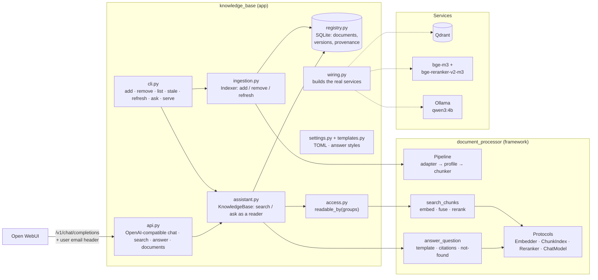

# knowledge_base — a tentative app on document_processor

Ask questions of your own documents, and get answers that cite the passages they came from.
Each reader sees only the documents their access groups allow.

```text
$ python -m knowledge_base ask "Dữ liệu vùng Staging được lưu trữ bao lâu?" --reader an@example.com
Dữ liệu vùng Staging được lưu trữ tối đa 07 ngày [1].

Nguồn:
[1] Quy định quản lý dữ liệu › Điều 2. Thời hạn lưu trữ
```

> **Status: tentative.** This first app layer gives the framework a shape to grow against.
> It is not hardened for production. See [Limits](#limits).

---

## How it fits together



**Where the line is drawn.** The framework knows nothing about readers, access groups,
SQLite, Ollama settings or Vietnamese. It works with protocols and with templates the
caller supplies. The app makes the concrete choices:

| Concern | Framework | App |
|---|---|---|
| Who may read a chunk | an attribute + `ChunkFilter` | `access_group` attribute, `readable_by()` |
| How to answer | `AnswerTemplate`, `answer_question()` | the `vn_regulation` / `general_en` styles |
| Which LLM | `ChatModel` protocol | `OllamaChatModel` from `[chat]` settings |
| What has been indexed | — | `SqliteDocumentRegistry` with versions |
| When to re-index | — | provenance comparison (`stale`) |

Only `wiring.py` loads models or opens connections. Everything else is tested with fakes.

---

## Quick start

**1. Services.** Qdrant and Ollama, on the same machine:

```bash
docker run -d -p 6333:6333 -v qdrant_data:/qdrant/storage qdrant/qdrant
ollama pull qwen3:4b          # ~2.6 GB; fits next to bge-m3 in 6 GB of GPU memory
```

**2. Install and configure.**

```bash
uv sync --extra huggingface --extra qdrant --extra ollama --extra app
cp knowledge_base.example.toml knowledge_base.toml   # edit [users]; it is git-ignored
```

The first command that needs the models downloads them to the folders in `[embedder]` and
`[reranker]`.

**3. Index documents.** Each one gets one access group:

```bash
python -m knowledge_base add data/docs/quy-dinh-du-lieu.docx --group it \
    --title "Quy định quản lý dữ liệu" --attribute kind=quy_dinh --attribute issued_on=2025-03-01
python -m knowledge_base add data/docs/hr/*.docx --group hr
python -m knowledge_base list
```

**4. Ask, or serve.**

```bash
python -m knowledge_base ask "Nhân viên được nghỉ phép bao nhiêu ngày?" --reader binh@example.com
python -m knowledge_base serve --host 127.0.0.1 --port 8000
```

---

## Connecting Open WebUI

The API looks like an OpenAI server with a single model, `knowledge-base`.

1. Start Open WebUI with user headers forwarded:
   ```bash
   docker run -d -p 3000:8080 -e ENABLE_FORWARD_USER_INFO_HEADERS=true \
       --add-host=host.docker.internal:host-gateway -v open-webui:/app/backend/data \
       ghcr.io/open-webui/open-webui:main
   ```
2. Go to **Admin Settings → Connections → OpenAI API → Add connection**:
   - URL: `http://host.docker.internal:8000/v1`
   - Key: anything; it is not checked.
3. Pick **knowledge-base** in the model menu.

Open WebUI sends the signed-in user's email as `X-OpenWebUI-User-Email`. The API maps it to
access groups through `[users]` in the settings. Unlisted users get `default_groups`.

The same API also suits any OpenAI client. Pass `X-Reader: someone@example.com` to choose the
reader yourself.

---

## Commands

| Command | What it does |
|---|---|
| `add PATH... --group G [--id] [--title] [--attribute N=V]... [--force] [--server URL]` | Index files. If nothing changed, it does nothing. If only the group or attributes changed, it rewrites them without re-embedding. Otherwise it indexes again as a new version. |
| `remove ID [--server URL]` | Takes the document's chunks out of the index and drops it from the registry. Its history is kept. |
| `list [--group G]` | Lists the documents held, with version, group and chunk count. |
| `stale` | Lists documents whose chunks would now come out differently, and why. |
| `refresh` | Re-indexes every stale document whose file still exists. |
| `ask QUESTION [--reader R]` | Answers as that reader, with sources. |
| `serve [--host] [--port]` | Runs the HTTP API. |

With `--server URL`, `add` and `remove` are done by the running server instead (see below).

`--config FILE` chooses the settings file. The default is `knowledge_base.toml` if it exists,
otherwise the built-in defaults.

## HTTP API

| Route | Purpose |
|---|---|
| `GET /health` | Liveness. |
| `GET /v1/models` | The one model, `knowledge-base`. |
| `POST /v1/chat/completions` | OpenAI chat. The question is the last user message, and the reply is the answer plus its sources. `stream: true` is supported; the reply arrives as one chunk. |
| `POST /v1/answer` | `{question}` → the answer with its structure: `found`, `passages`, `citations`, `stop`, `chat_model`. |
| `POST /v1/search` | `{question, limit}` → ranked passages with index and rerank scores. No LLM is involved. |
| `GET /v1/documents` | The documents the reader may see. |
| `POST /v1/documents` | Admin. `{path, group, document_id?, title?, attributes?, force?}` → indexes a file on the server's machine with the server's models. Returns `{document_id, action, version, chunk_count}`. |
| `DELETE /v1/documents/{id}` | Admin. Removes a document. |

Interactive docs are at `/docs` while the server runs.

## Adding documents while the server runs

A separate `add` loads its own copy of the models, which may not fit on the GPU next to a
running server and Ollama. Instead, ask the server to do it with the models it already has
loaded:

1. Set an admin token in `knowledge_base.toml`. The server and the CLI both read it from
   there:
   ```bash
   python -c "import secrets; print(secrets.token_urlsafe(32))"
   ```
   ```toml
   admin_token = "paste-it-here"
   ```
2. Restart `serve` once so it picks up the token. From then on, add and remove documents
   through it:
   ```bash
   python -m knowledge_base add data/docs/new.docx --group it --server http://127.0.0.1:8000
   python -m knowledge_base remove new --server http://127.0.0.1:8000
   ```

The new document is searchable from the next question, with no restart. The path is sent as
an absolute path and read by the server, so both must run on the same machine or share the
folder. The token comes from `--token`, then `$KNOWLEDGE_BASE_ADMIN_TOKEN`, then
`admin_token` in the settings. Without `admin_token`, the server refuses these requests
with 403.

Adds and removes run one at a time, so their version numbers can't collide. Questions keep
being answered while a document is indexed.

---

## Versions, provenance and stale documents

Each indexing run saves a new **version** of the document's record. Old versions are never
edited or deleted, so you can always explain what an index held at any point.

Each version records its **provenance**: what produced its chunks.

```text
source_hash  sha256 of the file          → you edited the document
profile      vn_regulation@<version>     → the structure rules changed
chunker      outline/512                 → chunk size changed
embedder     the embedder's identity     → a different model or settings
collection   knowledge-base              → indexed somewhere else
```

`stale` compares each document's provenance with what the current settings would produce.
After you change `chunk_tokens` or the embedder, `refresh` brings everything back in line.

## Access control

- Every chunk carries an `access_group` attribute, set at `add`. Every search filters on the
  reader's groups, and the filter runs inside the index, not after it.
- Searches also keep to `part = body`, so cover pages and signature blocks never become
  passages.
- `access_group` and `part` are reserved: `--attribute` refuses them.
- Adding and removing documents over the API needs `Authorization: Bearer <admin_token>`.
  Reading only needs the reader header.
- If the best passage a reader may see scores below `answer.min_score`, the answer is
  "not found" and the LLM is never called.

---

## Configuration

See [`knowledge_base.example.toml`](../../knowledge_base.example.toml). Every key is optional,
and unknown keys are refused, so a typo fails loudly instead of being ignored. The settings
you will most likely tune are:

| Key | Default | Notes |
|---|---|---|
| `chunk_tokens` | 512 | 256 scored slightly better on the one regulation tested. Changing it makes everything stale. |
| `reranker.enabled` / `depth` | true / 20 | On the test set, the reranker raised passage hit@1 from 0.73 to 0.90. |
| `answer.section_chars` | 10000 | When two or more hits share a section (e.g. the items of one khoản), the rest of it is added in document order, up to this many characters. The model then sees every part of a list instead of the top few. 0 turns it off. |
| `answer.min_score` | 0.3 | A first guess. Unanswerable questions scored at most 0.245 in one small test. Calibrate it on real questions. |
| `chat.model` | `qwen3:4b` | Any Ollama tag. Prefer an instruct tag: thinking-only models ignore `think = false`, and their reasoning is cut from the reply, but they are much slower. |
| `chat.timeout` | 120 | Seconds to wait for an answer. A slower one returns 504 (chat) or exits 1 (`ask`); Ollama down or the model missing returns 503. |
| `answer.template` | `vn_regulation` | `general_en` is the neutral English style. |
| `admin_token` | not set | Turns on `POST/DELETE /v1/documents` and `--server`. Must be at least 16 characters. |

## Tests

```bash
uv run pytest tests/knowledge_base tests/retrieval/test_answer.py tests/integrations/ollama
```

These tests use a word-hash embedder, the in-memory index, an in-memory SQLite registry and a
canned chat model. They need no GPU, no Qdrant and no Ollama.

---

## Limits

These are the known gaps, roughly in the order they will matter.

- **The reader header is trusted.** Anyone who can reach the port can claim any email. Bind
  to `127.0.0.1`, or put the API on a network only Open WebUI can reach. Real authentication
  comes later.
- **One question at a time.** Earlier turns of a chat are not used to interpret follow-ups
  such as "còn vùng khác thì sao?".
- **Indexing over the API takes a server path, not an upload.** The file must already be on
  the server's machine. An upload route is the next step if documents should come from a
  browser.
- **Streaming is cosmetic.** The whole answer is generated first and then sent as one chunk.
- **One group per document.** There are no per-section permissions and no group
  hierarchies.
- **Registry and index can drift if a step crashes.** If indexing fails partway, the registry
  keeps the previous version and the index may hold the new chunks. Running `add` again fixes
  it. A two-phase write would prevent it.
- **The `min_score` threshold is a guess** until there are more documents and real
  questions.
- **Restricted documents.** Everything runs locally, but think before pointing `chat.url` at
  a hosted model. Keep documents and question sets under the git-ignored `data/` folder.